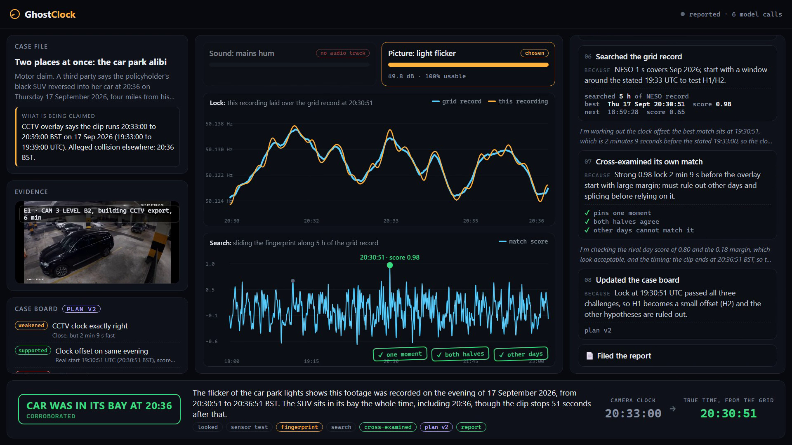
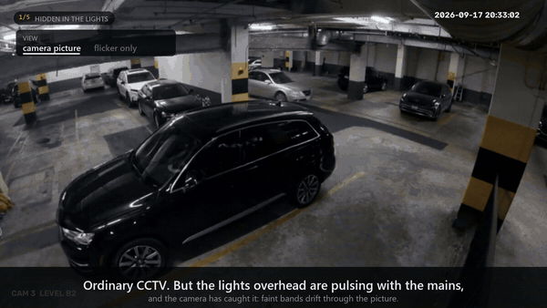
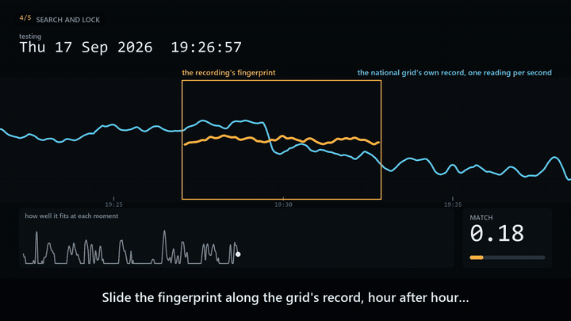
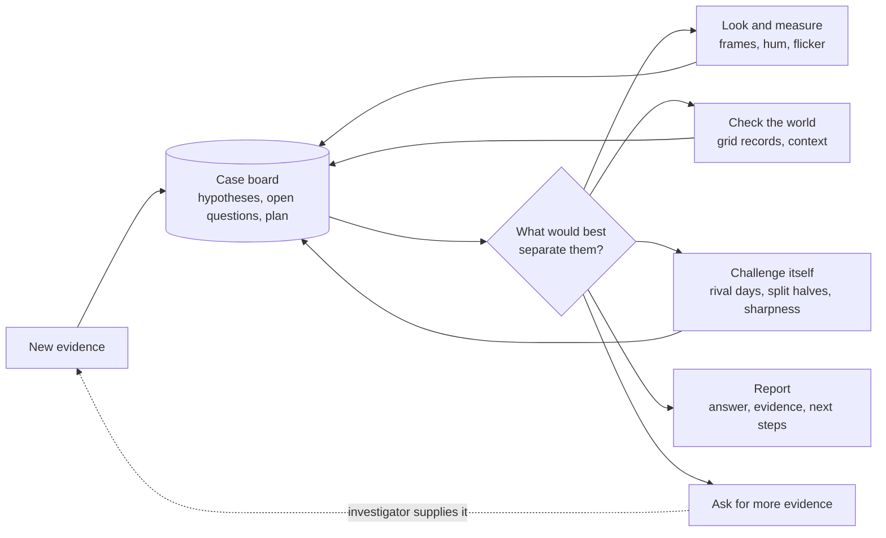
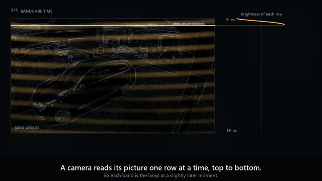
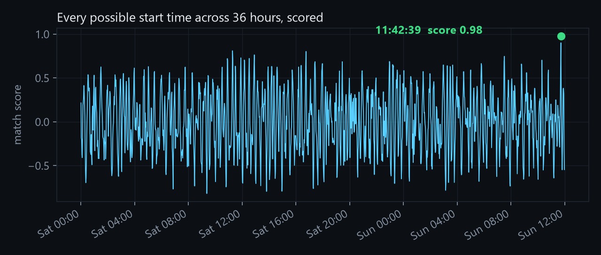

# GhostClock

**An autonomous investigator that works out when a recording was really made, from the flicker of the lights.**

Every mains-powered light pulses with the electricity grid, and the grid's frequency wanders in a pattern that never repeats. Cameras record that pulse without meaning to. GhostClock is an AI agent that finds it in a video, matches it against the national grid's own records, cross-examines its own answer, and tells an investigator what it means for their case.



## Who it is for

Claims handlers, fraud investigators, solicitors and police staff regularly have to decide whether to trust a timestamp on CCTV or phone footage. Recorder clocks drift, get reset, and can be edited. When the time matters, the usual answer is "we can't rely on it".

That has real consequences. In a UK Financial Ombudsman case ([DRN4869503](https://www.financial-ombudsman.org.uk/decision/DRN4869503.pdf)), a driver's own CCTV showed his car at home when it was supposedly in a collision elsewhere. The insurer said the car "couldn't have been in two places at the same time", decided his CCTV clock might be wrong, and recorded a fault claim against him.

GhostClock gives that investigator an independent clock.

## One investigation, start to finish

**The case.** A third party says a black SUV reversed into her at 20:36, four miles from the owner's flat. His building's car-park CCTV shows the SUV in its bay. The insurer says CCTV clocks drift, so the footage proves nothing.



**What the agent did** (a real run, 6 model calls, 45 seconds; full log in [`runs/carpark_alibi/`](runs/carpark_alibi/events.jsonl)):

| Step | The agent's decision | Result |
|---|---|---|
| 1 | Set up competing explanations: clock right, clock off, another day, edited, no usable signal | Case board, plan v1 |
| 2 | Looked at the frames | Underground car park, lit only by ceiling fittings, no audio track |
| 3 | Tested both sensors, chose the lights | Flicker strong, 100% usable |
| 4 | Read the grid's fingerprint from the flicker | 5.8 minutes of frequency trace |
| 5 | Checked which grid records exist, chose the 1-second archive | NESO, September 2026 |
| 6 | Searched five hours around the stated time | One fit: **20:30:51**, score 0.98. Next best 0.65 |
| 7 | Cross-examined that answer | Other days reach only 0.80. Both halves of the clip agree to 1 s. The fit collapses a few seconds away |
| 8 | Reported | **Car was in its bay at 20:36.** The recorder's clock runs 2 min 9 s fast |

It then told the handler what to do next: ask for a longer export and the ramp camera, get the exact collision time from the third party's photo, and check for a cloned plate.



## How the agent decides

GhostClock is not a fixed pipeline. It keeps a case board of competing explanations and picks whichever action best separates them.



Different evidence takes it down different routes:

| Case | What happened |
|---|---|
| 18-minute video, clock stated correctly | Audio drowned out by people talking, so it used the lights. Confirmed the time to 2 s. |
| Same video, clock stated 2 hours wrong | Found the true time, flagged a 2-hour discrepancy, and checked whether a timezone setting could explain it. |
| 5-minute excerpt | Confirmed the time but gave itself **medium** confidence because the lead over other days was modest. |
| 49-second clip | Refused to guess. Asked for a longer recording from the same phone, dated that one, and reasoned that the phone's clock could therefore be trusted. |

The tools (in [`agent/tools.py`](agent/tools.py)): `view_frames`, `probe_signals`, `extract_trace`, `grid_coverage`, `search_grid`, `challenge`, `research_context`, `update_case_board`, `request_evidence`, `submit_report`.

## Why it works

1. Mains electricity runs at about 50 Hz, but the exact frequency drifts by a few hundredths of a hertz as supply and demand shift. The drift is the same everywhere on the grid and never repeats.
2. Lights flicker at twice that frequency. A phone or CCTV camera reads its sensor one row at a time, so the flicker lands in the picture as faint bands, and the bands encode the frequency at each instant.
3. Grid operators publish the frequency second by second. Sliding the recording's trace along that record finds the one moment where it fits.



## Proof on real recordings

**Our own recording.** We filmed 18 minutes on a phone under ordinary ceiling lights at a hackathon venue. Searched blind against 36 hours of grid data, GhostClock placed the start at **11:42:39**. The phone's clock said 11:42:37.

| Blind search over 36 hours | The recording laid over the grid record |
|---|---|
|  |  |

**Excerpt benchmark** ([`eval/`](eval/)). We cut that recording into 43 excerpts of 2 to 12 minutes and searched each one blind across 7 days.

| Excerpt length | Excerpts | Answered | Correct (within 5 s) | Wrong |
|---|---|---|---|---|
| 2–3 min | 22 | 0 | 0 | 0 |
| 5 min | 9 | 1 | 1 | 0 |
| 8 min | 7 | 2 | 2 | 0 |
| 12 min | 5 | 5 | 5 | 0 |

It answers only when one moment clearly beats every other in the week and both halves of the clip agree. Otherwise it says so.

**Audio.** On 135 unseen five-minute clips from a public dataset (ENF-WHU), the same engine answered 105 and all 105 were within 5 seconds. On 153 recordings with no grid signal it produced no false matches. Details in [`docs/PROOF.md`](docs/PROOF.md).

## How often it works

Fifteen live agent investigations, on the demo case and on slices of our real recording with correct and deliberately wrong stated times: **11 dated correctly (all within 2 seconds), 4 declined to guess, 0 wrong answers.** In the wrong-time cases (clock off by 40 minutes, 2 hours, 1 to 3 days) the agent found the true time and reported the discrepancy. Results: [`eval/results/agent_cases.json`](eval/results/agent_cases.json); every run's decision log is in [`runs/`](runs/).

## What is real and what is reconstructed

- The venue recordings, the grid data, every agent run and every number above are real.
- The car-park case is a reconstruction of the ombudsman dispute. The footage is licensed stock with a CCTV overlay added, and its light flicker is simulated from the real GB grid record for the evening of 17 September 2026. The agent is not told the time. It recovers it blind, with the same tools it uses on the real recordings.

## Closest alternatives

- **Forensic audio labs** have used grid-frequency analysis for years, by hand, case by case, with their own reference recordings.
- **Open-source ENF matchers** take a prepared audio trace and return a best match. On a clip with a gap, the best-known one was off by 8 hours where our matcher was exact.

GhostClock is the investigator around the technique: it works from raw video, chooses the sensor, fetches the reference, tests its own answer against rival days, knows when to ask for more evidence, and writes the report.

## Run it

```bash
pip install -r requirements.txt          # Python 3.12, ffmpeg on PATH
echo ANTHROPIC_API_KEY=sk-... > .env
python -m agent investigate carpark_alibi
python -m uvicorn server.app:app --port 8765     # then open http://localhost:8765
python -m eval.bench_venue_excerpts              # the excerpt benchmark (no API key needed)
```

Replay a recorded run without an API key: open the UI and pick one under "replay a run".

## What is in this repo

| Path | What |
|---|---|
| `agent/` | The investigator: tool-use loop on Claude Opus 5.5, case board, evidence requests, safeguards |
| `ghostclock/` | Signal engine: rolling-shutter flicker and audio hum extraction, grid reference loader, matcher |
| `server/`, `web/` | Investigation UI: live decisions, charts and verdict |
| `eval/` | Benchmark on real excerpts |
| `runs/` | Decision logs of every investigation quoted above |
| `data/` | Cases, extracted traces and the grid records they are matched against |
| `docs/` | Proof details and images |

Built for the Imperial AI Hackathon 2026, Autonomous Agents track. Grid data: NESO and Elexon open data. Audio benchmark: ENF-WHU (MIT).
