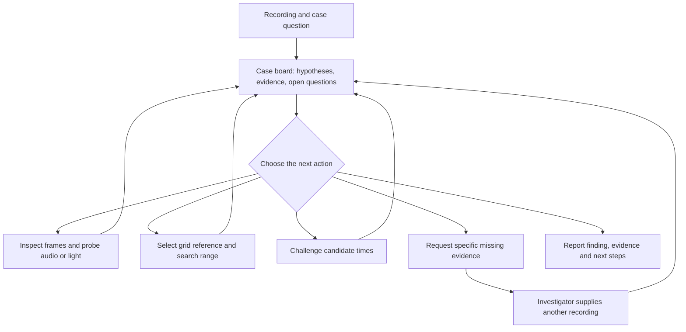
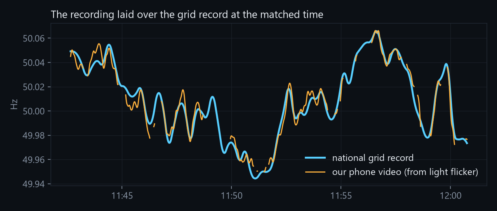

# GhostClock

GhostClock is an autonomous forensic agent that investigates disputed recordings, uses electrical signals in light and sound to check their timing, challenges its findings and asks for the evidence it still needs.


## Who needs to establish when a recording was made?

Claims handlers, solicitors, incident investigators and newsroom verification teams need to check whether recordings support disputed timelines. GhostClock gives them a timing finding, supporting measurements and a next investigative action.

## How can electricity reveal a recording's time?

The electricity grid's frequency varies around 50 Hz. Some recordings capture this **electrical network frequency (ENF)** variation in audio hum or lighting flicker. A **rolling-shutter** camera exposes successive rows at different times, allowing flicker to be measured within frames.

Numerical tools extract a frequency trace and use **cross-correlation against the national frequency record** to compare candidate start times. Timing information comes from changes in frequency over time. The agent chooses what to measure, where to search and how to test the result.

## How does the agent choose what to investigate?

Claude Opus 5.5 maintains competing explanations on a case board. Each tool call has a reason tied to an observation. Results return to the board and can change the next action.



Different evidence produces different decisions:

| Observation | Agent's response |
|---|---|
| Speech masks hum in the long phone video | Select light flicker instead. |
| A case states the wrong recording day | In recorded wrong-date cases, widen the search to neighbouring days and recover the time. |
| A 49-second clip has competing matches | Request a longer original recording from the same phone, then resume when supplied. |

The longer recording supported the phone clock, but the final report kept the **short clip inconclusive**: that clock check supports its time indirectly.

## What did the car-park demonstration establish?

The demonstration asks whether a black SUV was in its bay at **20:36 BST on 17 September 2026**, when a collision was alleged four miles away. The overlay starts at 20:33:00 BST.

The recorded investigation took **45 seconds and 6 model calls** ([decision log](runs/carpark_alibi/events.jsonl)).

| Question the agent tested | Decision and returned evidence |
|---|---|
| Which signal can be used? | No audio track; strong light flicker, with 100% of the extracted trace usable. Choose video. |
| Which reference is available? | Select the NESO one-second archive for September 2026; search five hours around the stated time. |
| Which start fits best? | **20:30:51 BST**, score **0.9826**; the next distinct candidate scores **0.6481**. |
| Does it survive challenge? | Three checks pass: rival days, independent halves and nearby offsets. Halves agree within 1 s; best neighbouring-day rival: about 0.80. |
| What does it mean for the case? | The corrected interval, **20:30:51–20:36:51 BST**, includes the alleged collision. The overlay is **2 min 9 s fast**. |

The report supports the alibi and recommends checking the third party's plate photo and requesting a longer export. The investigator decides how to proceed.

## What has been measured on real recordings?

Our **18.4-minute phone video** was dated from ceiling-light flicker because speech obscured the hum. A blind **36-hour** search of Elexon data found **11:42:39 UTC**, versus the network-synced phone clock's **11:42:37 UTC**: **2 s apart**. The search used the trace without the filename or metadata.

| Match scores across the 36-hour search | Extracted frequency trace against the grid record |
|---|---|
|  |  |

| Evaluation | Observed results |
|---|---|
| **15 live agent investigations**, including the demonstration and repeated phone-recording cases/slices | **11 dated within 2 s · 4 declined · 0 wrong answers** |
| **43 overlapping excerpts** of the long phone recording, searched blind across seven days | **8 answered, all within 5 s · 35 declined · 0 wrong** |
| Earlier ENF-WHU audio-engine test: **135 unseen five-minute clips**, each searched against its full recording day | **105 answered, all within 5 s · 30 declined**; **0 false matches on 153 no-grid recordings** |

Excerpts overlap and live cases reuse recordings; these are not independent camera trials. See [test conditions](docs/PROOF.md), [agent case scores](eval/results/agent_cases.json) and [run logs](runs/).

## When does it ask for more evidence?

The method needs a usable grid-related signal and sufficient duration. GhostClock selects NESO's one-second archive where available or Elexon's 15-second feed. If matches remain ambiguous, it can request a longer original or another recording, pause and resume when supplied.

A match score measures correlation. Timing corroboration alone does not establish identity, location or complete authenticity.

## How does GhostClock relate to existing tools?

ENF is an established forensic technique; [GRIDPRINT](https://devpost.com/software/alibi-nbizax) is a closely related agentic project. GhostClock focuses on selecting evidence, challenging times, requesting missing recordings and reporting what the findings mean for a case.

## Run the investigation or replay a recorded run

Requirements: **Python 3.12**, **ffmpeg on PATH**, and an Anthropic API key for live model calls.

```bash
pip install -r requirements.txt
```

Create `.env` in the repository root with your key:

```dotenv
ANTHROPIC_API_KEY=your_api_key
```

```bash
python -m agent investigate carpark_alibi
python -m uvicorn server.app:app --port 8765
```

Open **http://localhost:8765** for the UI. To replay without an API key, choose a recorded run under **"replay a run"**.

Run the excerpt benchmark without an API key:

```bash
python -m eval.bench_venue_excerpts
```

The raw phone recordings are not included in the repository; their extracted traces are in `data/cases/venue/`.

## What is in the repository?

| Path | Contents |
|---|---|
| `agent/` | Claude tool-use loop, case board, evidence requests and reports |
| `ghostclock/` | Rolling-shutter and audio extraction, grid reference loading and matching |
| `server/`, `web/` | Investigation UI, decisions, charts and verdict |
| `eval/` | Excerpt benchmark and agent evaluations |
| `runs/` | Recorded investigation decisions and reports |
| `data/` | Cases, extracted traces and grid reference data |
| `docs/` | Evidence details and images |

Built for the **Imperial AI Hackathon 2026 · Autonomous Agents** track. Grid data: NESO and Elexon. Audio benchmark: ENF-WHU.
