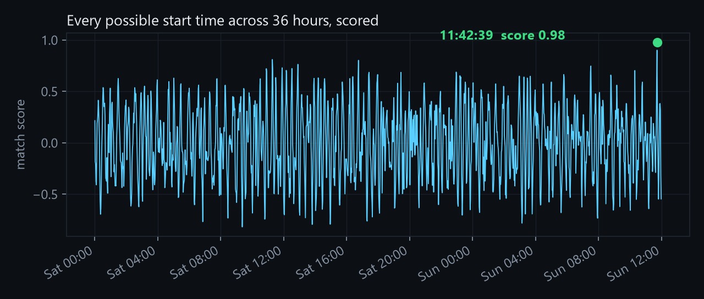
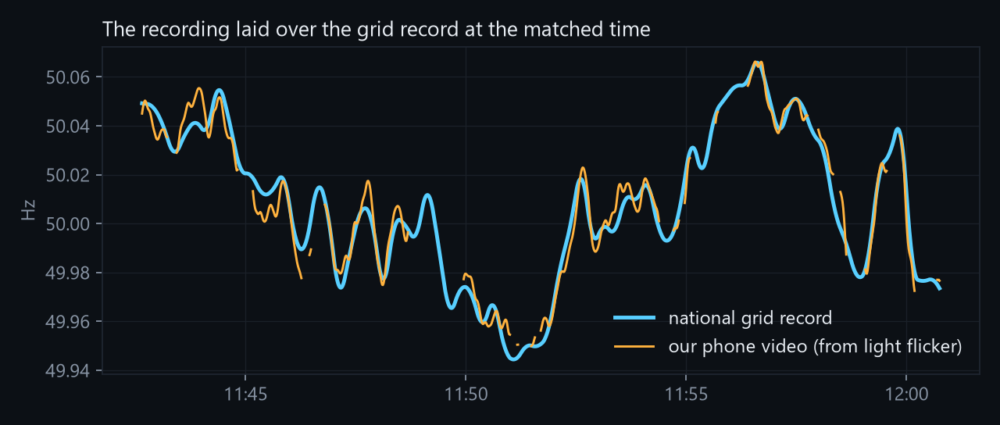

# Proof that it works on real recordings

Everything on this page uses real recordings and real grid data.

## 1. Our own phone video, dated to 2 seconds

On Sunday 8 November 2026 we filmed 18.4 minutes on a phone (1080p, 60 fps) in a room lit by ordinary ceiling strip lights, with people talking in the background.

| | |
|---|---|
| Sensor used | Light flicker, read from the camera's rolling shutter. The audio hum was drowned out by speech (17% usable), so the agent rejected it. |
| Reference | Elexon's public feed of Great Britain's grid frequency (one reading every 15 seconds) |
| Search | Blind, across 36 hours. The search is given only the extracted trace: no filename, no metadata. |
| **Result** | **11:42:39 UTC.** The phone's network-synced clock said **11:42:37**. |
| How decisive | Match score 0.98. The best score anywhere else in the 36 hours was 0.83. |

The agent's own run on this recording is in [`runs/venue_hero/`](../runs/venue_hero/events.jsonl). Its challenges:

- **Other days:** the best match on any day from 5 to 11 November scored 0.84.
- **Split halves:** the first and second halves of the video, matched separately, give start times 2 seconds apart.
- **Sharpness:** moving the start by 10 seconds drops the score from 0.98 to about 0.92; by a minute, to 0.70.

## 2. Excerpt benchmark: 43 excerpts, no wrong answers

Run it yourself: `python -m eval.bench_venue_excerpts` (no API key needed; results in [`eval/results/`](../eval/results/venue_excerpts.md)).

We cut the same recording into 43 overlapping excerpts of 2 to 12 minutes. Each one is searched blind across seven days (5–11 November) using the same search and challenge logic as the agent. It answers only if the best match scores at least 0.80, beats every other moment in the week by 0.05, and both halves agree within 10 seconds.

| Excerpt length | Excerpts | Answered | Correct (within 5 s) | Wrong |
|---|---|---|---|---|
| 2 min | 11 | 0 | 0 | 0 |
| 3 min | 11 | 0 | 0 | 0 |
| 5 min | 9 | 1 | 1 | 0 |
| 8 min | 7 | 2 | 2 | 0 |
| 12 min | 5 | 5 | 5 | 0 |

Declining short clips is the right behaviour against a 15-second reference. If the rule were dropped, 9 of the 11 three-minute excerpts would have produced a wrong answer, because some other day matched slightly better. With the 1-second archive (published a few weeks in arrears), shorter clips become datable.

All 43 excerpts come from one recording and overlap, so they are not independent tests.

## 3. The agent on real evidence

| Run | Evidence | Outcome |
|---|---|---|
| [`venue_hero`](../runs/venue_hero/events.jsonl) | 18-minute video, clock stated correctly | Corroborated, high confidence. 11:42:39 against a stated 11:42:37. |
| [`venue_wrongclock`](../runs/venue_wrongclock/events.jsonl) | Same video, stated time 2 hours late | Discrepancy, high confidence. Found 11:42:39 and flagged the 2-hour gap. |
| [`venue_5min`](../runs/venue_5min/events.jsonl) | 5-minute excerpt | Corroborated, medium confidence. Within 2 seconds, and it explained why it would not say "high". |
| [`venue_short`](../runs/venue_short/events.jsonl) | 49-second clip | Declined. Asked for a longer recording. |
| [`venue_two_files`](../runs/venue_two_files/events.jsonl) | 49-second clip, with another recording available on request | Asked for it, dated the longer recording, and concluded the phone's clock was accurate to about 2 seconds. |

### Further live runs on slices of the same recording

Each case gives the agent a slice of the recording and a stated start time that is either right or deliberately wrong. The agent never sees the truth. Scored by `eval/run_agent_cases.py` (correct = within 5 seconds).

| Run | Evidence | Outcome |
|---|---|---|
| [`eval_8min_a`](../runs/eval_8min_a/events.jsonl) | 8 min slice, stated correctly | Correct, 1 s off, corroborated |
| [`eval_8min_b`](../runs/eval_8min_b/events.jsonl) | 8 min slice, stated 40 min early | Correct, 1 s off, discrepancy |
| [`eval_12min_a`](../runs/eval_12min_a/events.jsonl) | 12 min slice, stated correctly | Correct, 2 s off, corroborated |
| [`eval_12min_b`](../runs/eval_12min_b/events.jsonl) | 12 min slice, stated 1 day early | Declined, asked for more evidence |
| [`eval_full_wrongday`](../runs/eval_full_wrongday/events.jsonl) | 18 min slice, stated 1 day late | Correct, 2 s off, discrepancy |
| [`eval_3min`](../runs/eval_3min/events.jsonl) | 3 min slice, stated correctly | Declined, asked for more evidence |
| [`eval_10min_c`](../runs/eval_10min_c/events.jsonl) | 10 min slice, stated 2 days late | Correct, 1 s off, discrepancy |
| [`eval_11min_d`](../runs/eval_11min_d/events.jsonl) | 11 min slice, stated almost 3 days early | Correct, 1 s off, discrepancy |
| [`eval_14min_e`](../runs/eval_14min_e/events.jsonl) | 14 min slice, stated correctly | Correct, 1 s off, corroborated |

One of the two declines (`eval_12min_b`, stated a day early) was a miss: the agent searched only the stated day and asked for more evidence instead of widening to neighbouring days. We tightened its search guidance after that run; the three cases run afterwards (`eval_10min_c`, `eval_11min_d`, `eval_14min_e`) include two stated days off, and it widened and found the true time in both.

**Tally across all 15 live investigations: 11 correct (all within 2 s), 4 declined, 0 wrong.**

The raw venue recordings are 2.9 GB and are not in the repository. Their extracted frequency traces are (`data/cases/venue/`), so every run and the benchmark can be repeated.

## 4. Audio, on a public benchmark

The audio extractor and matcher were tested earlier on the public ENF-WHU dataset, with settings frozen before the test recordings were touched:

- 135 unseen five-minute clips, each searched across its full day: **105 answered, all 105 within 5 seconds** of the truth; 30 declined.
- 153 recordings with no grid signal: **0 false matches**.
- Against per-file refined timing: 31 of 34 within 1 second, median error 0.18 s.

That work, including its scripts and trial tables, is public at https://github.com/Banana-CCV/ghostclock (folder `experiments/c1_enfwhu_unseen_holdout`).
